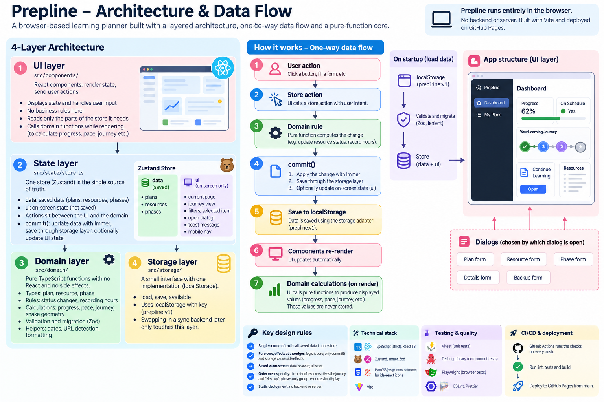

# Prepline

Collect the articles, videos, courses and practice you plan to get through, and follow them as a preparation journey toward a target date. Prepline shows how far you've come, what to work on next, and whether you're on track.

## Features

- **Plans:** several independent plans, each with a target date, optional daily study hours and a description. Switch, edit, duplicate or delete them from **My Plans**.
- **Resources by link:** type and title are guessed from the URL (YouTube → video, Udemy/Coursera → course, LeetCode/HackerRank → practice, everything else → article). The list order is your priority order.
- **Statuses:** Not Started, In Progress or Completed. Several resources can be in progress at once. Starting one counts no hours, you record the hours you've done, and reopening restores earlier progress.
- **Progress by hours, not item count:** an overall ring, hours done and remaining, days left, and an On Track / At Risk / Behind status when daily hours are set.
- **Preparation journey:** a winding roadmap with a step for each resource, showing which are done or in progress and which comes next. It becomes a vertical list on phones.
- **Optional phases:** group resources into milestones such as "Foundations" or "System Design", with a description and colour. The Phases view shows progress per phase, weighted by hours. Resources without a phase stay under "Unorganized".
- **Continue Learning:** a card that points to the first resource in progress, or the next one to start.
- **Resource list:** filter by type and status, change status from each row, drag rows by their handle to reorder (or use the arrow keys on the handle), and move resources between phases.
- **Backups:** data is saved in the browser (localStorage). You can export it as JSON, and importing checks the file and shows a preview before anything is replaced.
- **Responsive design** with light and dark themes. The sidebar switch follows your system setting or keeps the one you pick.

## Architecture

Prepline runs entirely in the browser. It has four layers (UI, state, domain and storage), one-way data flow and a core of pure functions.



## Development

Requires Node 22 or newer.

```bash
npm install
npm run dev          # dev server at http://localhost:5173/prepline/
npm test             # unit tests (Vitest)
npm run test:e2e     # browser tests (Playwright); run `npx playwright install chromium` once first
npm run lint
npm run typecheck
npm run build        # production build in dist/
```

Built with Vite, React, TypeScript, Zustand and Zod.

## Deploy to GitHub Pages

1. Push the repo to GitHub. If it is not named `prepline`, change `base` in `vite.config.ts` to `/<repo-name>/`.
2. In the repo, go to **Settings → Pages** and set **Source** to **GitHub Actions**.
3. Every push to `main` builds and deploys the site through `.github/workflows/deploy.yml`. It is live at `https://<your-username>.github.io/prepline/`.

## Data

Everything lives in your browser's localStorage under the key `prepline:v1`. Clearing site data erases it, and it does not sync between browsers or devices. Use **Backup and restore** to export a JSON file now and then.
